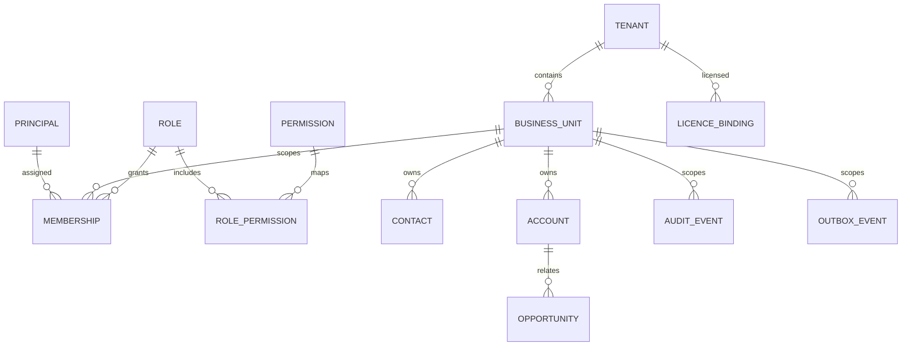

# CEPHAS CRM — Platform, API, audit and deployment blueprint
Status: proposed design, not implemented or accepted. Baseline: 04d8366e1ca44c8231dff54f98dd39d8379179be.
Traceability: ADR-0001–0008; Gate 0.1.4 D01–D06; Gate 0.1.5 S01–S07; original work packages 0.1.4, 0.1.8, 0.1.9.

## P01 — Logical ERD and ownership

Logical design, not migration DDL. Tenant/BU keys are non-null; BU references tenant via composite key; membership PK (tenant_id, bu_id, principal_id, role_id), role must be scoped to same tenant/BU unless immutable global template mapped through constrained administration. Principal identity unique by verified issuer/subject, not email. Tenant-wide authority tables are inaccessible directly to runtime and accessed through narrowly authorised functions. BU-owned entities use PK (tenant_id, bu_id, object_id); dependent relationships use same composite FK, even where object IDs are UUIDs. No unclassified runtime-readable table. No shared cross-BU data or hierarchy inheritance until separately reviewed. Schema changes require inventory update.

## P02 — Initial policy inventory (proposed, not installed)
| Table/group | Classification | Normal runtime policy |
|---|---|---|
| tenant, business_unit, principal, membership, role, role_permission | Protected authority | No direct access; constrained bootstrap and authorised management interfaces |
| permission, immutable module catalogue | Global reference | SELECT only, no tenant-private data |
| context key and transaction registry | Protected verifier metadata | No direct grants; vetted verifier only |
| licence_binding, usage limits/counters | Protected tenant entitlement metadata | Scoped entitlement/reservation functions; no direct self-grant |
| account, contact, opportunity (future domain) | BU-owned | FORCE RLS; SELECT/UPDATE/DELETE USING, INSERT/UPDATE WITH CHECK; authenticated exact tenant and BU; column grants and action checks |
| audit_event | BU-owned or separately classified system audit | Scoped append only; restricted read; no runtime UPDATE/DELETE; no wildcard system scope |
| outbox_event, job execution | BU-owned | Scoped append and authorised processing; no broad worker read; worker design deferred |
The actual migration inventory must account for every relation, view, trigger, partition, function and effective grant. Apply Gate 0.1.5 B01–B14; no claim that RLS is proven. Domain tables listed for architecture only; no implementation authorised.

## P03 — REST API and integration standard
Versioned /api/v1, JSON UTF-8, explicit request and response schemas, bounded payloads, pagination with opaque scoped cursor, deterministic sorting, allowlisted filters. Tenant/BU path/header is selector only; verified identity and active membership establish context. Object IDs do not confer access. Use 401 for missing/invalid identity, 403 for denied actions where disclosure safe, 404 for hidden/foreign objects with consistent response semantics, 409 for conflict/idempotency mismatch, 429 for quotas, 503 for unavailable security dependency; stable machine error code and correlation ID, no stack traces or private context. Use conditional writes/version checks for concurrent updates. Mutation idempotency key scoped to tenant/BU/actor/operation and request digest, durable unique constraint, atomic result/outbox; same key different payload rejected. No automatic retries for ambiguous non-idempotent operations. API keys/service identities scoped, rotated and separate from human sessions.
Webhooks: verify configured per-integration key over original bytes and signed timestamp/event ID; enforce bounded timestamp window, durable deduplication scoped to tenant/integration; reject duplicate identifiers with differing digest; customer-controlled egress allowlist, TLS validation, SSRF/DNS/redirect protection, bounded timeouts and backoff. No direct provider access to DB or model tools. Define exact signature grammar, tolerance/retention and contract version before integration enablement.

## P04 — Audit integrity
Audit actor/service identity, verified tenant/BU, event ID, event schema, action, target reference, outcome, UTC timestamp, correlation ID and reason code; avoid PII content, tokens and full licence. Successful security-relevant mutations and audit/outbox atomic; denied attempts recorded separately in bounded protected path. Append-only ordinary grants, separate audit custodian; per-scope sequence and previous hash plus canonical event digest, serialised head advancement, verify gaps/forks and restore continuity. Hash chain alone is not protection against privileged rewrite/truncation. Independent checkpoint export to customer-controlled append-only/WORM storage or approved offline signed checkpoint custody required before claims of privileged-tamper detection. Anchor failure policy, event canonicalisation, retention, key ownership and reconciliation remain open. No hidden CEPHAS access or mandatory external egress.

## P05 — Deployment and DR
Initial on-prem/private cloud Linux amd64 Docker Compose: customer TLS reverse proxy -> web -> API; separate context issuer and identity provider; PostgreSQL on isolated network, only authorised roles; protected secret volumes/customer vault; no public database/queue/admin ports; default-deny egress; non-root application containers, read-only filesystem where feasible, resource limits, health/readiness checks and no secrets in images/logs. Context issuer credentials isolated from SQL runtime; signing keys remain at CEPHAS for licence/release, not customer site. Customer imports verified pinned image digests, SBOM, trust bundle and offline install materials. Worker/cache/search optional and disabled pending isolation tests.
Backup: encrypted customer-owned DB base backups plus WAL where supported, protected config and trust-state recovery materials stored separately, retention and immutable offsite copy per policy. Proposed initial engineering DR target RPO <= 24h, RTO <= 8h for agreed reference dataset; not an SLA or demonstrated result. Restore to isolated network, verify artifacts/permissions/schema/tenant tests, reconcile licence/anchor/epoch state, rotate affected secrets, approve before cutover; no rollback to weaker security state. Review expand/contract upgrades, migration failure, backup compatibility and restore drill. Customer retains data and recovery authority. Sizing, retention, key custody, RPO/RTO and identity provider selection require customer/profile approval and tested evidence.
